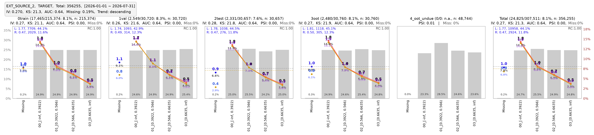

# 2 · 哪些特征有区分度，而且足够稳定？

<div class="mars-cases" markdown="1">

本批保留 Home Credit 两张 application 表的全部 356,255 条记录。TARGET 来自原比赛训练表，比赛测试表的 48,744 条记录保持 null。APPLY_DATE 是按 ID 稳定散列生成的演示日期。0train 用于拟合和 PSI 基准，1val 用于验证或筛选，2test 与 3oot 用于固定结果的独立复核，4_oot_undue 仅表示比赛未公开标签。日期、元数据和角色映射见[输入方案与分区说明](../user-guide/home-credit-data.md)。

## 本批实际结果

[打开报告](../assets/cases/binning.html) · [有限查询与结论](../assets/cases/case-2.json)

--8<-- "docs/assets/cases/previews.txt:case2"

只在 0train 拟合固定分箱，并以它作为 PSI 参考分布；五组复用同一分箱。
主图是 EXT_SOURCE_2 的 MARS 原生趋势图，完整展示一次。EXT_SOURCE_3、AMT_INCOME_TOTAL、DAYS_BIRTH 可在报告中继续查询。
完整候选 fcols 与有限展示字段分别记录在 manifest；有限图表不代表只分析了这些字段。
无标签组保留箱占比与适用 PSI，IV、KS、AUC 和已观测 Bad Rate 按实际未观测状态解释。
count、observed_count 与未观测人数以报告字段为准；本例不设权重，KS 为 0–100，Bad Rate 为 0–1，IV/PSI 无量纲。
模拟月趋势另存 binning-time.marsreport；模拟时间差异不能证明真实业务 OOT。

[](../assets/cases/binning-native-home-credit.svg)

[下载 300 dpi PNG](../assets/cases/binning-native-home-credit.png) · [查看 SVG](../assets/cases/binning-native-home-credit.svg) · [原生图参数与查询来源](../assets/cases/binning-native-evidence.json)

图由 MarsBinningReport.save_risk_trend_images() 直接导出，保留原生布局、坐标与标签。AMT_CREDIT 是贷款金额，使用公开数据的原始金额单位，不解释为利润或损失。

=== "人工分析"

    从报告查看真实表与图，按实际分母判断。完整可运行代码使用共享准备入口，复用同一宽表与固定参考样本。

    ```python
    --8<-- "docs/snippets/task_cases.py:binning"
    ```

=== "Agent 消费"

    新进程按目录读取已保存统计；实际有限 JSON 中的引用可重放。

    ```python
    from mars.reporting import load_report

    report = load_report("binning.marsreport")
    print(report.describe())
    page = report.query_page("summary", features="EXT_SOURCE_2", limit=3)
    print(page["reference"], page["data"])
    ```

    ??? example "实际查询结果与分页引用"

        ```json
        --8<-- "docs/assets/cases/query-2.json"
        ```

## 运行与下载

```bash
python docs/snippets/task_cases.py --case 2 --data-dir examples/home-credit-2018/data/raw_data --output-dir output/task-cases
```

首次生成全部关联证据用 --case all。文件缺失会明确失败，正式入口不回退合成数据。
[数据下载与输入准备](../user-guide/home-credit-data.md) · [完整共享源码](../snippets/task_cases.py) · [共享包](../assets/cases/cases.zip) · [来源和哈希](../assets/cases/manifest.json) · [案例索引](index.md)

</div>
