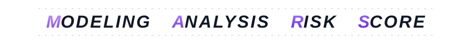

<div class="mars-home" markdown="1">

<div class="mars-home-hero" markdown="1">

<picture class="mars-home-logo-wrap">
<source media="(prefers-reduced-motion: reduce)" srcset="assets/mars-logo.svg">

</picture>


<p class="mars-home-badges">
  <a href="https://pypi.org/project/mars-risk/"></a>
  <a href="https://leeesq.github.io/mars-risk/"></a>
  <a href="https://pypi.org/project/mars-risk/"></a>
  <a href="https://pepy.tech/project/mars-risk"></a>
  <a href="https://github.com/leeesq/mars-risk/actions/workflows/test.yml"></a>
  <a href="https://github.com/leeesq/mars-risk/blob/main/LICENSE"></a>
</p>

# 面向人和 AI Agent 的高性能信贷风控工具箱

**数据画像 · 分箱评估 · 特征筛选 · 相关性分析 · 模型分交叉 · 规则挖掘**

用 Pandas 或 Polars 宽表分析信贷风险，查看图表、查询统计并导出报告。

分析人员用原生图表判断风险，AI Agent 从同一份报告中查询证据。

<div class="mars-home-actions">
<a class="mars-home-button mars-home-button-primary" href="getting-started/quickstart/">开始分析 →</a>
<a class="mars-home-button" href="demos/">查看实战案例 →</a>
<a class="mars-home-button" href="user-guide/external-agents/">面向 AI Agent →</a>
</div>

</div>

<figure class="mars-home-preview mars-native-preview">
<a href="assets/cases/binning-native-home-credit.svg" aria-label="查看原生分箱趋势图高清 SVG">

</a>
<figcaption>Home Credit 外部来源分 EXT_SOURCE_2，直接导出自 MARS 分箱报告，APPLY_DATE 为模拟日期。点击查看高清图。<br>
<a href="demos/binning-stability/">分箱与稳定性实战 →</a> · <a href="assets/cases/binning.html">打开交互式报告 →</a></figcaption>
</figure>

## 把分析结果变成可以继续使用的证据

MARS 使用 Polars 计算，接受 Pandas 或 Polars 宽表。你可以检查数据质量，
评估分箱后的风险，筛选特征，分析相关性并挖掘规则。报告保留统计结果，
供你按特征、标签、客群和时间比较，查看图表，并导出 HTML、Excel 或高清图片。

外部 AI Agent 通过公共报告接口查询同一份结果。表目录、指标口径、特征业务元数据和
计算状态会随报告保存。Agent 可以在新会话中继续查询，通过证据引用核对回答，
也可以调用你选择的模型库和实验工具。

## 从工作任务开始

<div class="mars-task-grid">
<a class="mars-task-card" href="demos/data-quality/"><em>PROFILE</em><strong>数据能直接用吗？</strong><span>检查缺失与特殊值、标签覆盖、字段结构和分布变化。</span><span class="mars-card-link">数据画像 →</span></a>

<a class="mars-task-card" href="demos/binning-stability/"><em>BIN / EVALUATE</em><strong>特征有区分度，而且稳定吗？</strong><span>固定分箱边界，用原生图比较各分区的分布和风险，查看多目标指标。</span><span class="mars-card-link">分箱与风险评估 →</span></a>

<a class="mars-task-card" href="demos/selection-correlation/"><em>SELECT</em><strong>为什么保留这个，删除另一个？</strong><span>查看候选、筛选步骤和保留／删除的实际理由。</span><span class="mars-card-link">特征筛选 →</span></a>

<a class="mars-task-card" href="demos/selection-correlation/#correlation"><em>CORRELATION</em><strong>哪些特征提供了重复信息？</strong><span>分别查看原始值（raw）和 WOE 的相关系数，判断相关方向与冗余。</span><span class="mars-card-link">相关性分析 →</span></a>

<a class="mars-task-card" href="demos/score-cross/"><em>SCORE CROSS</em><strong>两项外部来源分如何共同区分风险？</strong><span>固定两项分数的分段，比较交叉格子的风险梯度和组合条件。</span><span class="mars-card-link">模型分交叉 →</span></a>

<a class="mars-task-card" href="demos/rule-evidence/"><em>RULE MINING · EXPERIMENTAL</em><strong>规则在独立样本上表现如何？</strong><span>查看候选规则的来源、筛选理由、覆盖范围和独立验证结果。</span><span class="mars-card-link">规则挖掘 →</span></a>
</div>

[七个实战案例与完整下载](demos/index.md) · [保存后继续查询](demos/saved-reports.md) ·
[交付给人和 Agent](demos/report-delivery.md)

当前案例使用 Home Credit 两张 application 表共 356,255 条申请；原始特征与标签来自比赛，APPLY_DATE 为模拟日期。五分区与无标签含义见[输入方案](user-guide/home-credit-data.md)。图表和查询读取同一批保存报告。

## 基于 MARS，构建你的 Agent

MARS 负责计算并提供分析证据。你负责组织 Agent 的操作步骤，选择训练工具，并制定业务决策流程。

| 场景 | 可复用能力 | 可以形成的结果 |
| --- | --- | --- |
| 建模 Agent | 数据质量、分箱评估、特征筛选、相关性、风险评估 | 选出候选特征，查看淘汰理由，将评估结果交给自选训练工具 |
| 监控与归因 Agent | 分组画像、缺失和分布变化、固定分箱风险趋势、稳定性 | 定位变化人群与特征，提出待验证的归因假设 |
| 规则分析 Agent | 候选规则、命中评估、发现审计、独立验证 | 审查候选规则的风险、覆盖范围和独立验证结果 |
| 报告分析 Agent | 表目录、业务元数据、分页、快照、证据引用 | 在新会话继续查询，通过证据引用核对回答 |

你需要自行实现这些 Agent 工作流。MARS 也提供可选的内置 Agent，
它同样使用公共报告接口。[查看外部 Agent 指南](user-guide/external-agents.md) ·
[规则证据与 Agent](user-guide/rule-reports-and-agents.md)

## 计算一次，持续使用

先按 [Home Credit 输入指南](user-guide/home-credit-data.md)准备三个 CSV，放入
`examples/home-credit-2018/data/raw_data/`。在仓库根目录运行
`python docs/snippets/readme_quickstart.py`，即可生成图表、HTML 和快照。
单独复制代码时，将[准备脚本](snippets/home_credit_data.py)放在代码所在目录，并按指南准备数据路径。
随后可以在另一个进程加载快照，查询同一份结果。

=== "人：查看与交付"

    ```python
    --8<-- "docs/snippets/readme_quickstart.py:quickstart"
    ```

=== "AI Agent：查询与复用"

    ```python
    from mars.reporting import load_report

    --8<-- "docs/snippets/minimal_report.py:agent"
    ```

    加载后得到 ReportSnapshot，其中包含已保存的统计结果和元数据。
    查询无需原始宽表或内置 Agent 会话；调用 `restored.show_table("summary", limit=10)` 可查看汇总表。

<div class="mars-home-values">
<div><strong>业务信息随结果保留</strong><span>保存已提供的标签定义、单位和来源，记录实际参数，标明未知信息。</span></div>
<div><strong>按需读取分析证据</strong><span>先筛选行、选择列并分页，再生成限制字符数的 JSON。</span></div>
<div><strong>跨会话继续分析</strong><span>加载快照后，仍可查询表目录和统计结果，核对报告身份与证据引用。</span></div>
</div>

JSON 摘要可以粘贴到对话框，`max_chars` 按字符计数，不按 token 计数。
具备 Python 或工具调用能力的 Agent 可以加载 `.marsreport`，继续查询已有统计。
需要新增分析维度或查看原始记录时，必须读取原数据重新计算。

<div class="mars-callout" markdown="1">

## 当前迭代方向

**Analysis、Feature、Reporting 为 Stable；Rule、Monitoring、Modeling、Pipeline、Scoring、Agent 为 Experimental。**
这些标记说明接口成熟度。

当前重点是提高分析的计算速度、减少内存占用，并改进人工查看和外部 Agent 查询报告的体验。
**监控、建模（包含 Pipeline）、评分卡暂时停止功能迭代**。我们保留现有功能和文档，
处理必要修复，并在核心接口变化时直接修改这三个下游模块的调用代码。
核心代码不为它们增加兼容别名或冗余计算。
你可以结合编程型 AI、MARS 分析报告和自选模型工具，构建适合业务的流程。

[稳定性与适配原则](project/stability.md) · [建模／Pipeline](user-guide/modeling-pipeline.md) ·
[监控](user-guide/monitoring.md) · [评分卡](user-guide/scorecard.md)

</div>

**MARS 0.0.28 已发布到 PyPI**，使用以下命令安装固定版本。

```bash
pip install mars-risk==0.0.28
```

main 开发使用源码：

```bash
pip install "git+https://github.com/leeesq/mars-risk.git"
```

[安装与可选依赖](getting-started/installation.md) · [API Reference](reference/index.md) ·
[历史 LightGBM 示例](demos/history.md) · [GitHub](https://github.com/leeesq/mars-risk) ·
[MIT License](https://github.com/leeesq/mars-risk/blob/main/LICENSE)

</div>
